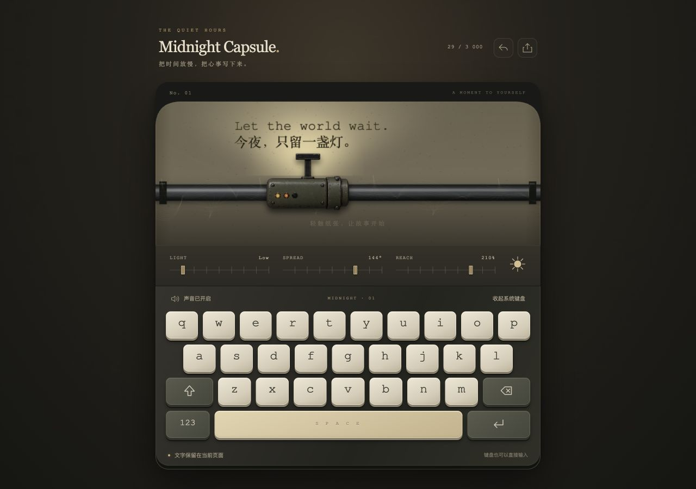
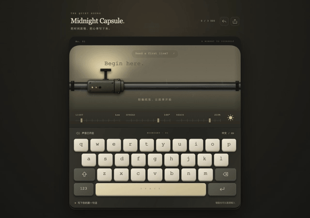
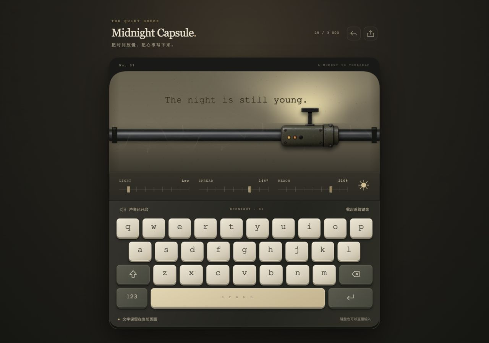
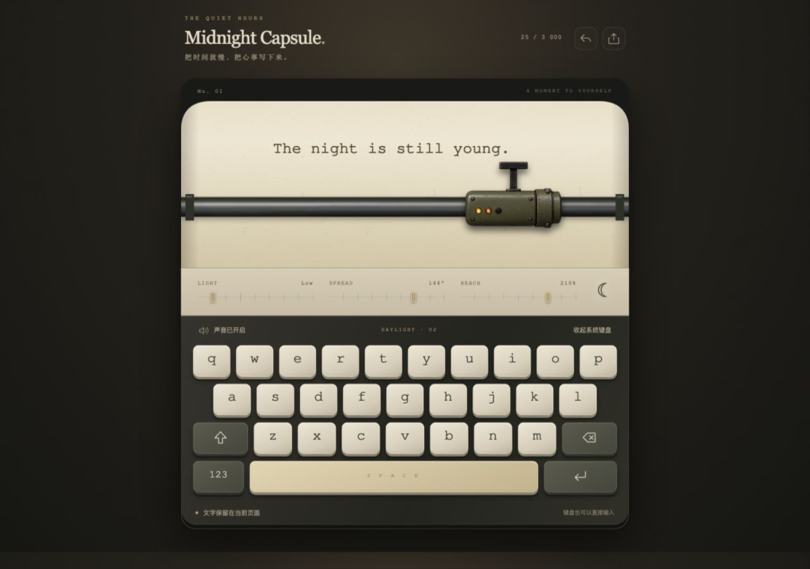
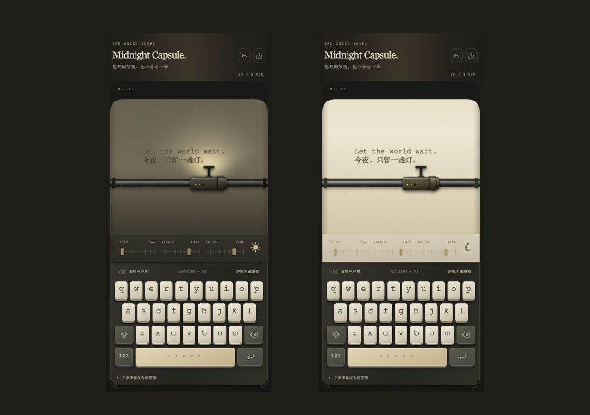

# 午夜打字机 · Midnight Capsule

一台带有纸张纹理、移动机械字车、微光和敲击音效的浏览器打字机。



当前首页为材质增强版：柔光灯、暖纸边缘、金属反光、立体键帽和重新排版的页头。
原始复刻保留在 `/original/`，打开 <http://127.0.0.1:4173/original/index.html> 可对照。
增强版验证与手机截图见 [材质改进记录](docs/refinement.md)。

## 视频演示



[观看或下载完整 MP4 演示](docs/media/midnight-capsule-demo.mp4) · [视频与截图说明](docs/media/README.md)

24.47 秒，1280 × 900，30 fps，无音轨。前半段来自真实页面的打字与灯光操作录制，放慢播放以便观察；后半段展示白昼模式和手机截图。

## 截图

| 午夜模式 | 白昼模式 |
| --- | --- |
|  |  |



## 本地运行

需要 Node.js 18 或更新版本，无需安装依赖。

```sh
cd "midnight-capsule-typewriter"
npm start
```

打开 <http://127.0.0.1:4173>。端口占用时可运行 `PORT=4174 npm start`。
也可使用任何静态 HTTP 服务器运行项目根目录。

## 功能

- 午夜 / 白昼模式、亮度 / 范围 / 距离调节。
- Canvas 纸张、金属导轨、移动字车、蛛网和微光动画。
- 屏幕键盘、实体键盘、大小写、数字符号、退格、空格和换行。
- 点击「中文 / EN」后使用系统中文输入法。
- 首句灵感、最多 3000 字、换纸确认、下载 UTF-8 文本。
- Web Audio 合成机械音效与静音开关。
- 移动布局和减少动态效果偏好支持。

文字仅保留在当前页面；刷新或关闭页面后不会恢复，离开前请下载文字。
首次点击纸张或键盘后才会解锁声音，这是原站的行为。

## 文件

```text
index.html             页面结构
style.css              原站样式与响应式规则
app.js                 原站交互、动画与声音
refinement.css         增强版材质与版式
original/              保留的初版页面、样式和脚本
typewriter.otf         原站字体
carriage.png           金属字车
rail.png               导轨纹理
paper-grain.png        纸张纹理
scripts/serve.mjs      无依赖本地预览服务器
source-manifest.json   来源、抓取日期与 SHA-256
docs/verification.md   验证记录
```

## 来源与复刻范围

来源：[原站](https://midnight-capsule-typewriter.zzzzzzzzz1.chatgpt.site/)，抓取日期：2026-10-10。
初版保存公开提供的完整前端文件及其引用资源，HTML 移除了 Cloudflare 注入的部署验证脚本。
之后按用户要求增强了首页排版与 Canvas 材质；`original/` 保留初版实现，仅调整资源路径以便在子目录预览。
字体和图片仍为原站资源。`source-manifest.json` 分别记录抓取时与当前文件的哈希。
未复制浏览器中用户已经输入的文字或浏览器状态。

这是可独立运行的前端复刻。原站当前实现没有业务后端、远程数据保存或账户功能。
未获取未公开的服务端源代码。声音由代码实时合成，无外部音频依赖。
未发现原站授权声明，因此本项目不另行给原站代码、字体和图片授予开源许可证。

## 检查

```sh
npm run check
```

项目无构建步骤，托管静态文件即可运行。
