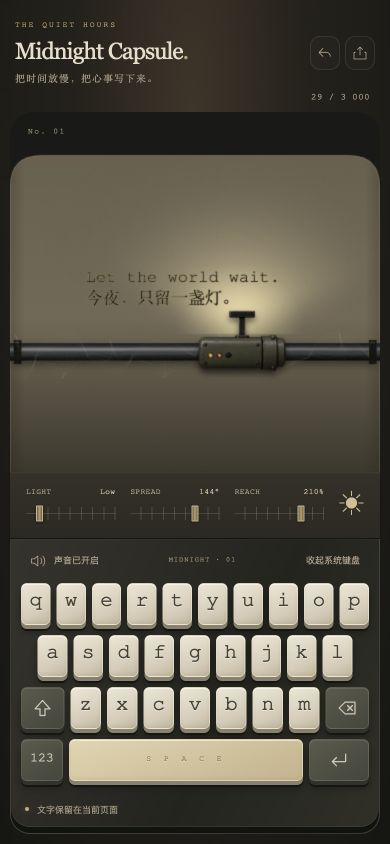
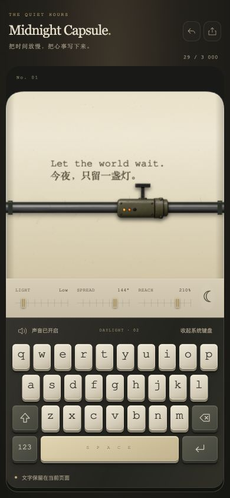

# 材质改进记录

2026-10-10，按用户「让质感更加好」的要求改进本地项目。

## 视觉与交互

- 暖灰、奶油纸与黄铜配色；衬线标题、中文副标题和紧凑工具区。
- 键帽增加倒角高光、底部厚度和接触阴影，功能键与空格键使用不同材质。
- Canvas 纸张增加暖色纤维、边缘阴影和轮廓高光。
- 灯光在复用的离屏画布中模糊，消除原有的锐利三角边缘；只有字车位置、灯光参数或画布尺寸变化时才重绘光层。
- 金属导轨、字车增加亮度、轻微暖色与接触阴影；蛛网降为细微背景层，移除电弧闪烁。
- 按实际纸面高度显示最近几行，避免前面的行被纸张上沿截断；完整文字仍可下载。
- 小于 650 像素高的窗口可纵向滚动访问全部控件。

## 验证

| 检查 | 结果 |
| --- | --- |
| `npm run check` | 通过 |
| 桌面 1280 × 900 | 标题、场景、灯光控制和键盘完整可见 |
| 手机 390 × 844 | body 宽度 390，机器底部 844，31 个按键，无横向溢出 |
| 窄屏 320 × 568 | scrollWidth 320，scrollHeight 660，可纵向滚动访问底部键盘 |
| 屏幕按键、退格 | 正常更新文字与计数 |
| 中英文多行文字 | 正常渲染 |
| 主题、灯光 | 切换白昼正常；亮度滑块 100 显示 High |
| 控制台 | 未读到 error / warn |

没有进行真实手机、真实输入法候选词或扬声器输出测试；文字下载文件落盘核验沿用初版的未验证状态。
此验证记录生成时尚未上传；随后用户明确要求上传到公开 GitHub 仓库。

## 设计实现原则

应用继续使用原有静态页面与 Canvas，不新增依赖（KISS、YAGNI）。
材质样式集中到 refinement.css，交互继续沿用现有状态（单一职责）。
光照复用一个离屏画布；字体与图片由初版和增强版共用，避免资源重复（DRY）。
original/ 的脚本与样式作为独立历史对照保存。

