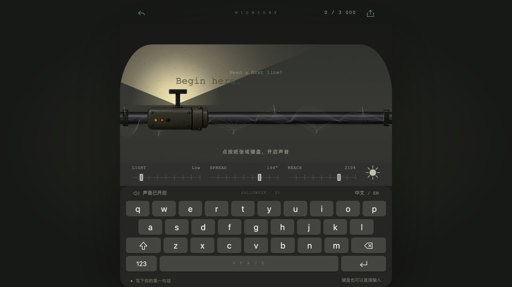
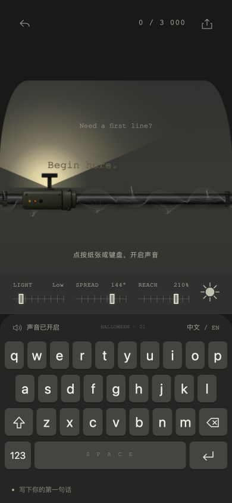
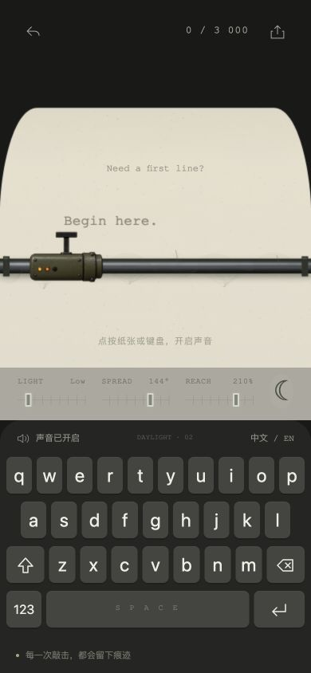

# 初版复刻验证记录

此记录对应材质改进前的初版。当前首页的验证与截图见 [材质改进记录](refinement.md)。

日期：2026-10-10。验证浏览器：Codex 内置浏览器。
运行地址：http://127.0.0.1:4173/。

| 检查 | 结果与证据 |
| --- | --- |
| JavaScript 语法 | `npm run check` 通过 |
| 本地文件完整性 | 清单中 7 个文件 SHA-256 全部匹配 |
| HTTP 与资源 | 7 个网站文件均返回 200，响应内容与本地文件一致 |
| 屏幕键盘 | 输入 q、启用 Shift 输入 W、空格、数字 1、退格、换行；结果为 `qW \n`，计数 4 |
| 明暗主题 | DAYLIGHT / HALLOWEEN 标签、主题按钮和 Canvas 视觉随切换更新 |
| 灯光控制 | 亮度 100 显示 High，范围 70 显示 70°，距离 80 显示 80% |
| 中文文字输入 | 开启系统键盘入口，文本框接受中文与英文多行文字，计数 30；未使用真实操作系统输入法进行人工候选词测试 |
| 音效开关 | 按钮在「关闭音效」「开启音效」间切换，显示「静音」；未独立验证扬声器输出 |
| 换纸确认 | 对话框显示清空提示；取消后内容保留，确认后内容和计数归零 |
| 首句灵感 | 点击后观察到逐字输入从 T 开始；逻辑按原站代码保留 |
| 文本下载 | 点击后显示「文字已下载到你的设备」；浏览器未提供下载文件句柄，落盘内容未核验 |
| 桌面布局 | 默认 1280 × 720 视口截图见 desktop-midnight.jpg |
| 手机布局 | 390 × 844 视口，body 和 canvas 宽度均为 390，31 个键可见，无横向溢出 |
| 控制台 | 验证过程中未读取到 error / warn 日志 |

## 截图

## 边界

原站 CSS、JavaScript、字体和图片保持抓取时的原文件内容。
Canvas 包含随时间变化的蛛网和随机反馈，截图不是逐像素相似度测量。
没有运行实体手机测试、真实输入法候选词测试或离线浏览器网络拦截测试。
全部运行依赖已保存在本地；原应用无远程字体、图片或音频调用。
此初版记录生成时尚未上传；随后用户明确要求上传到公开 GitHub 仓库。
